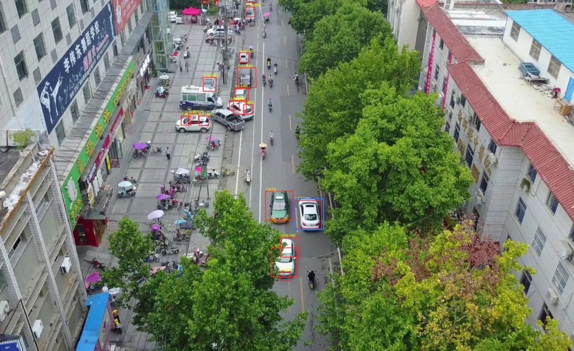
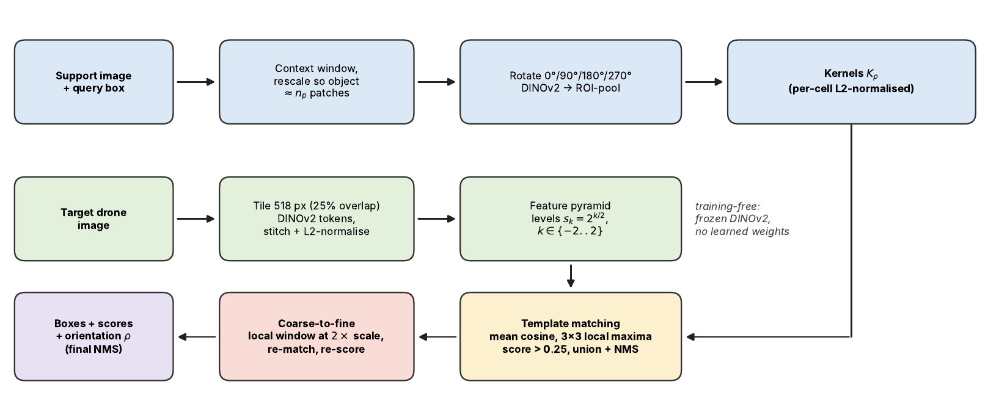

# Visual Object Search in Drone Images

Training-free, query-by-example object search in drone images using frozen DINOv2 patch features.
Course project for EE604 (IIT Kanpur).

**Author:** Ashish Pratap Singh (Roll No. 261010070), ashishps26@iitk.ac.in

**Task.** Input: a target drone image and a query (a box drawn around an object on a support image).
Output: a ranked list of boxes in the target image that contain the same kind of object, plus the estimated rotation of the match.
No training or fine-tuning is done for a new object.



## Method in brief

All components use a frozen DINOv2 ViT-B/14 (`facebook/dinov2-base`); nothing is learned.

1. **Tiled feature pyramid.** The target image is resized at half-octave scales, split into 518 px tiles (25% overlap), embedded, stitched and L2-normalised.
2. **Rotation-aware query encoding.** The support window is rotated by 0/90/180/270 degrees and re-embedded (ViT features are not rotation-equivariant); the tokens inside the box become a kernel.
3. **Multi-scale template matching.** Mean cosine similarity between kernel and feature map; 3x3 local maxima above 0.25 become candidates, merged with NMS.
4. **Coarse-to-fine refinement.** The top 150 candidates are re-matched in a local window at 2x resolution and re-scored.



## Results (117 one-shot episodes from VisDrone-DET val)

Mean per-episode AP at IoU 0.5 and Recall@100, in %. This is per-episode AP, not class-averaged mAP, so it is not comparable with published VisDrone numbers.

| Config | Method | AP50 | R@100 | s/episode |
|---|---|---|---|---|
| A | Single scale | 4.49 | 8.13 | 0.16 |
| B | Fixed pyramid | 10.64 | 29.16 | 1.19 |
| C | Adaptive pyramid | 8.97 | 28.27 | 1.80 |
| D | C + rotation | 8.48 | 30.31 | 1.85 |
| E | D + coarse-to-fine | 12.51 | 36.41 | 3.74 |
| F | B + coarse-to-fine | **13.59** | 31.68 | 2.52 |
| G | F + rotation (final) | 13.50 | 35.80 | 3.04 |
| - | OWL-ViT tiled, 1x | 2.36 | 7.28 | 0.63 |
| - | OWL-ViT tiled, 2x | 3.54 | 15.29 | 2.58 |

Coarse-to-fine refinement is the most useful component. Rotation helps recall but not AP. The query-adaptive pyramid did not help. F and G were added after seeing the A-E results, so results involving them are exploratory. See the report for confidence intervals, size breakdown, limitations and failure cases.

## Repository layout

```
experiments/visdrone_search_experiments.py   full pipeline, baseline, benchmark, ablation (notebook-style, "# %%" cells)
demo/gradio_demo.py                          Gradio demo cell (needs the experiment cells defined first)
report/                                      final PDF report + LaTeX source, bib, CVPR style, figures
figures/                                     figures used in the report
requirements.txt
```

## Setup

```bash
pip install -r requirements.txt
```

A GPU is strongly recommended (experiments were run on a single Kaggle GPU). Model weights are downloaded from the HuggingFace hub on first use.

## Data

Download VisDrone2019-DET (train and val, with `images/` and `annotations/` folders) from the official page:
https://github.com/VisDrone/VisDrone-Dataset

Place the dataset under the working directory (or `/kaggle/input` on Kaggle). The code finds the `train` and `val` split folders automatically.

## Reproducing the experiments

`experiments/visdrone_search_experiments.py` is a notebook exported as a script. Each `# %%` marker starts a cell.
Open it in VS Code / Jupytext / Spyder as cells, or paste the cells in order into a Kaggle or Colab notebook (GPU on, internet on) and run them top to bottom:

1. Imports, VisDrone helpers, backbone, query encoding, search, metrics, episode construction, OWL-ViT baseline.
2. Smoke test on a few images, then the full benchmark (117 episodes on 60 val images, seed 0).
3. `n_p` tuning on held-out images (seed 1), final ablation A-G, paired bootstrap confidence intervals, qualitative figures, IoU diagnostic.

Seeds: 0 for evaluation episodes, 1 for tuning episodes, 0 for the bootstrap.

## Interactive demo

Run the experiment cells that define `DinoBackbone`, `TargetFeatures`, `SearchConfig` and `run_search` first, install Gradio (`pip install gradio`), then paste `demo/gradio_demo.py` as one new cell and run it.
Upload a drone image, click two opposite corners of the object, and press **Search**.

Note: the demo marks the query on the same image, which is easier than the cross-image queries used in the evaluation, and it can merge overlapping boxes for display (switchable). Neither is part of the evaluated pipeline.

## Report

[`report/Visual_Object_Search_in_Drone_Images_Report.pdf`](report/Visual_Object_Search_in_Drone_Images_Report.pdf)

To rebuild: `cd report && pdflatex main && bibtex main && pdflatex main && pdflatex main` (all files needed, including the code listings, are in `report/`).

## Links and credits

- VisDrone dataset: https://github.com/VisDrone/VisDrone-Dataset
- DINOv2 code: https://github.com/facebookresearch/dinov2 ; weights: https://huggingface.co/facebook/dinov2-base
- OWL-ViT weights (baseline): https://huggingface.co/google/owlvit-base-patch32

## Acknowledgement

An AI assistant (Claude, Anthropic) was used to help draft the report text. All experiments were run and all reported numbers were checked by the author.
